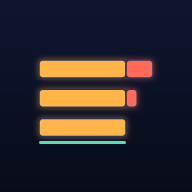
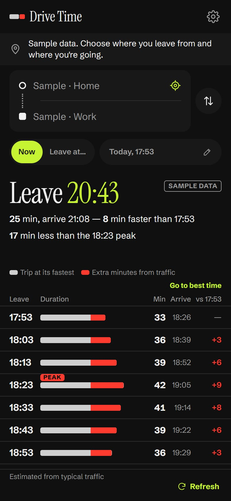
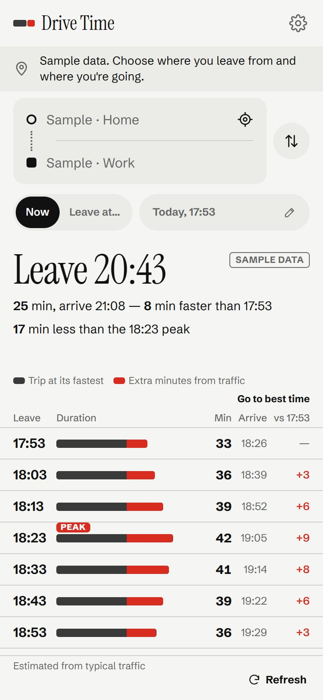
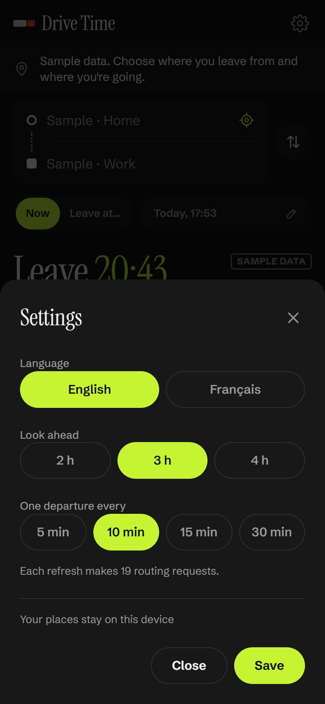
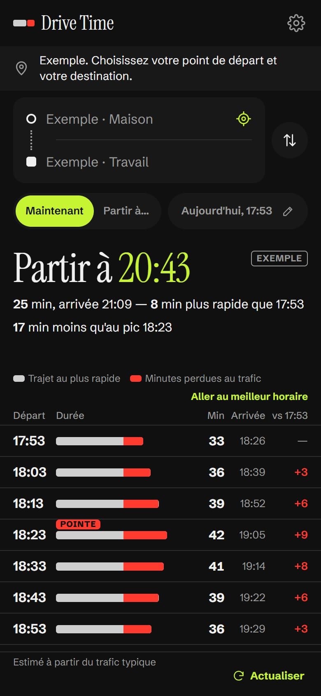

<p align="center">
  
</p>

<h1 align="center">Drive Time</h1>

<p align="center"><strong>When should I leave? See the car travel time for a list of departure times, side by side.</strong></p>

<p align="center">
  <a href="https://github.com/LightSeek3r/drive-time/actions/workflows/ci.yml"></a>
  <a href="LICENSE"></a>
  <a href="CHANGELOG.md"></a>
  
  
</p>

<p align="center">
  <a href="https://drive-time.unit42.fr/"><strong>Open the app</strong></a> ·
  <a href="https://www.unit42.fr/projects">Project page on unit42.fr</a> ·
  <a href="CHANGELOG.md">Changelog</a> ·
  <a href="https://github.com/LightSeek3r/drive-time/issues">Report an issue</a>
</p>

<table>
  <tr>
    <td width="25%"></td>
    <td width="25%"></td>
    <td width="25%"></td>
    <td width="25%"></td>
  </tr>
</table>

Pick where you start and where you are going, and Drive Time lines up the car travel time for a list
of departure times: your start time, then one departure every 10 minutes for three hours (19 rows).
Settings change the look-ahead (2, 3 or 4 hours) and the step (5, 10, 15 or 30 minutes), up to 25
rows. Each bar is the trip at its fastest plus the minutes traffic adds, and the best time to leave
is called out with the minutes it saves. Tap a row to restart the list at that time. Free, no
account, no analytics.

Installable PWA, English and French. Home, Work and your last trip are stored in the browser only.
The app shows sample data until you choose a start and a destination.

## How it works

Travel times come from the [TomTom Routing API](https://developer.tomtom.com/) with `departAt`,
which blends typical traffic for that weekday and time of day with live traffic when the departure
is close. Waze has no public API, and no routing service gives predictive traffic without a key.

The TomTom key never reaches the browser. The app calls its own `/api/*` routes, and a small Worker
([`worker/`](worker)) adds the key as a secret before forwarding to TomTom. It only forwards the two
calls the app makes, accepts same-origin browser requests, and rate limits per IP (60 requests per
minute), so the key cannot be spent on anything else.

Each refresh makes one routing request per row (19 with the default window, 25 at most; Settings
shows the count). Results are cached for 5 minutes. Refresh is manual, plus an automatic one when
you come back to the tab after more than 5 minutes. That keeps the app inside TomTom's free tier
(20,000 routing and 20,000 geocoding requests per month, no card required).

### Live traffic adjustment

TomTom returns, for each departure, the typical duration (`historicTrafficTravelTimeInSeconds`) and a
duration from real-time speeds (`liveTrafficIncidentsTravelTimeInSeconds`). When the first departure is
within 10 minutes of the request, the app takes `live / typical` (clamped to 0.7 to 2.5) and applies
it to every row's typical duration, fading with `exp(-minutes ahead / 60)`. Rows start from the typical
figure, not from TomTom's own blend, so a jam is not counted twice. The footer says when this is on
("Adjusted for live traffic (+7 min)"). The logic is in
[`src/domain/calibration.ts`](src/domain/calibration.ts); the 60-minute decay is a guess to tune with
real data.

## Run it yourself

```sh
npm install
npm run dev        # http://localhost:5173 (UI only, /api/* is not served)
npm test           # Vitest
npm run typecheck
npm run build      # production build and service worker
npm run preview    # serve the build on http://localhost:4173
npm run icons      # regenerate the PNG icons from public/icons/icon.svg
```

To use real travel times locally, create a free TomTom key, put `TOMTOM_API_KEY=...` in a gitignored
`.dev.vars` file, then run `npm run build` followed by `npx wrangler dev`.

Geolocation and service workers need HTTPS in production (localhost is exempt).

## Deploy

Drive Time is a Cloudflare Worker with static assets ([`wrangler.jsonc`](wrangler.jsonc)), served on
`drive-time.unit42.fr`. To run your own copy, change the `routes` entry (or remove it to use the
`workers.dev` address) and set the key as a Worker secret:

```sh
npx wrangler secret put TOMTOM_API_KEY
npm run deploy
```

Without the secret `/api/*` answers 503 and the app shows a "service unavailable" message.
`wrangler.jsonc` also declares the rate limit binding; if its `namespace_id` is already used by
another Worker in your account, change it.

Push-to-deploy uses Workers Builds: in the Cloudflare dashboard, Workers & Pages, connect the GitHub
repository, then set the build command to `npm run build`, the deploy command to `npx wrangler
deploy` and the production branch to `main`. The Worker name in the dashboard must match `name` in
`wrangler.jsonc`, which is still `home-timer` from the project's first name (the app was called Home Timer until 0.6.0).

## Layout

- `src/domain` pure logic: departure slots and window, summary, live-traffic calibration, RFC 3339 times, sample data
- `src/providers` the `TrafficProvider` seam, the TomTom client (calls `/api/*`), and the throttled, cached estimate stream
- `worker` the Cloudflare Worker that proxies `/api/*` to TomTom with the secret key
- `src/storage`, `src/hooks` versioned localStorage stores and React hooks
- `src/components`, `src/styles` the UI and design tokens (night theme with automatic light theme)
- `src/i18n` English and French strings; a test keeps the two in step
- [`PRODUCT.md`](PRODUCT.md), [`DESIGN.md`](DESIGN.md) product and design context

## Known limits

- Predictions are estimates from typical traffic, not guarantees. The live adjustment is a heuristic, and the `historic` and `live` fields were only checked against a hand-written fixture, not a real TomTom response.
- The furthest future date TomTom accepts for a chosen start time has not been verified with a real key.

## Contributing

Issues and pull requests are welcome, see [CONTRIBUTING.md](CONTRIBUTING.md). Security reports go
through [SECURITY.md](SECURITY.md). Released under the [MIT licence](LICENSE).
